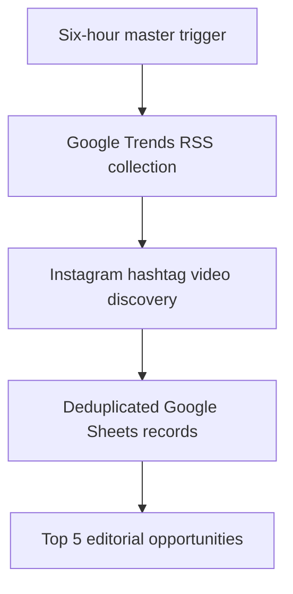

# AndActionBTB Sports Trends ETL

**Automated sports trend discovery and editorial intelligence** built with Google Apps Script, Google Trends RSS, Meta Instagram Graph API, and Google Sheets.

**Status:** Operational prototype. This repository contains a sanitized, reproducible **reference implementation**, not a byte-for-byte export of the live Apps Script project.

## Pipeline

The single master workflow runs three stages in order: Google Trends, Instagram discovery, and Top 5 ranking.

## Features

- **Scheduled ETL:** one six-hour Apps Script trigger
- **Cross-source ingestion:** Google Trends RSS and authorized Instagram hashtag discovery
- **Coverage:** MLB, UFC, NCAAF, NFL, NHL, NBA, soccer, and tennis
- **Deduplication:** Instagram media IDs prevent repeated entries
- **Editorial prioritization:** up to five recent video candidates, with league-level Google Trends alignment
- **Security:** token and operational IDs read from private Apps Script Script Properties
- **Observability:** execution logs and per-hashtag error reporting

## Tech stack

JavaScript · Google Apps Script · UrlFetchApp · SpreadsheetApp · XML/RSS · Meta Graph API · Google Sheets

## Source files

| File | Purpose |
|---|---|
| [GoogleTrends.gs](src/GoogleTrends.gs) | RSS ingestion and sports classification |
| [InstagramReels.gs](src/InstagramReels.gs) | Hashtag discovery and video filtering |
| [SportsTop5.gs](src/SportsTop5.gs) | Recency and league-alignment ranking |
| [MasterAutomation.gs](src/MasterAutomation.gs) | Sequential execution and scheduled trigger |
| [SETUP.md](docs/SETUP.md) | Deployment instructions |
| [SECURITY.md](docs/SECURITY.md) | Credential and data-handling practices |

## Setup

See **[docs/SETUP.md](docs/SETUP.md)**. Configure `SPREADSHEET_ID`, `INSTAGRAM_ACCOUNT_ID`, and `INSTAGRAM_ACCESS_TOKEN` as **Script Properties**. Never commit actual tokens.

## Interpretation

The Top 5 is an **editorial shortlist, not a verified viral ranking**. Instagram hashtag discovery is limited by Meta's permissions and quotas. Media marked `VIDEO` is not necessarily a Reel. League-level overlap does not prove that a specific video matches a Google Trends story. Public view counts and engagement data may not be available.

## Next improvements

Story-level topic matching, historical report snapshots, API quota monitoring, alerting, mocked tests, and engagement enrichment where permitted.

**AndActionBTB** — data-driven sports content intelligence.
